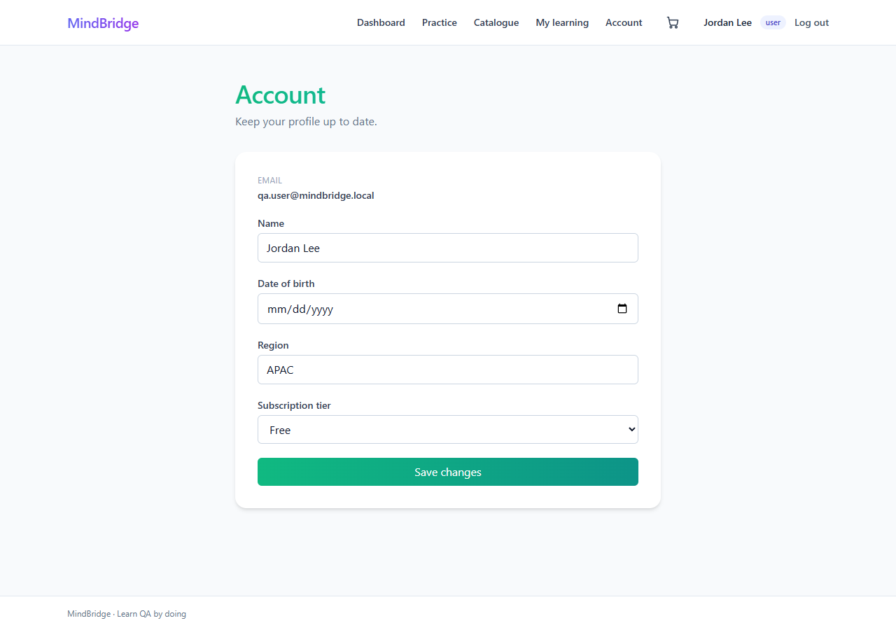

# MindBridge — QA Automation and Release Reporting

Account-update automation, SQLite data validation and stakeholder reporting for a course-provided mock learning platform.

## Context

Educational lab from the Microsoft Junior QA/Software Tester certificate on Coursera. MindBridge and its framework are provided by the course. This repository presents completed lab artifacts plus separately documented verification performed during portfolio preparation.

## Scope and results

| Work | Evidence |
| --- | --- |
| 1 Playwright account-update test | **1 passed**, exit code 0, in a Windows rerun on 2026-10-21 |
| Backend validation | Profile region changed from EMEA to APAC and persisted in SQLite |
| Reporting | Reviewed a supplied 14-result nightly fixture: 5 passed, 9 failed, 35.7% |
| Data-quality review | Identified 6 explicit timeout entries versus 7 textual mentions counted by the original generator |
| Traceability | Local simulated ticket MB-142 linked to local PR #1 |

The 14-result log is supplied analysis data, including retries. It is separate from the single account-update test and is not evidence of 14 tests written for this project.

## Explore the work

| Area | Artifact |
| --- | --- |
| Submitted automation | [account_update.spec.js](tests/account_update.spec.js) |
| User validation | [Safe field selection](sql/user-validation.sql) |
| Added persistence verification | [Profile-region SQL join](sql/account-update-persistence.sql) |
| Runner evidence | [Passing output](evidence/windows-rerun/playwright-run.txt) |
| SQL verification | [Structured results](evidence/windows-rerun/results.json) |
| EOD communication | [Reviewed report](reports/reviewed-eod-report.md) |
| Input data | [Synthetic nightly log](data/raw-nightly-logs.txt), [metric audit](evidence/nightly-log-audit.json) |
| Prompt | [Original sandbox prompt](prompts/original-eod-prompt.txt) |
| Simulated workflow | [Local ticket and PR](docs/local-workflow/) |
| Provenance | [Review notes](docs/review-notes.md) |



## Tools and environment

JavaScript, Playwright, SQL/SQLite, Chrome and a local course report-generation sandbox. Jira/PR activity is simulated locally. The rerun used Windows, Node 24.15.0, Playwright 1.64.1, installed Chrome, and better-sqlite3 12.11.1 in a temporary working copy. The original lab dependency was 11.10.0.

## How to run in the course lab

This is an evidence portfolio; the course application, setup tools, runtime database and dependency tree are not redistributed. With the lab app running at localhost:3000, prepare fictional user 101 using the supplied setup script. Copy the curated test to the lab tests folder and run from that lab root:

```sh
python3 tools/prepare_project_user.py
npx playwright test tests/account_update.spec.js --project=chromium
```

The [Windows verification config](evidence/windows-rerun/playwright.windows.config.ts) records the Chrome channel used in the separate rerun and assumes a lab-root working directory. The local seed credential in the test belongs only to the mock application.

## Release assessment

The supplied nightly fixture supports holding the simulated build while checkout failures are investigated. The separate passing account-update test does not establish release readiness for the broader suite. No production deployment occurred.

## Original versus reviewed output

The original EOD report is retained under reports/original. It describes seven timeout occurrences because its generator counted a summary mention as an event. Use the reviewed report for corrected interpretation. The user-data export omits password hashes, and raw databases are excluded. See review notes for all curation changes.
